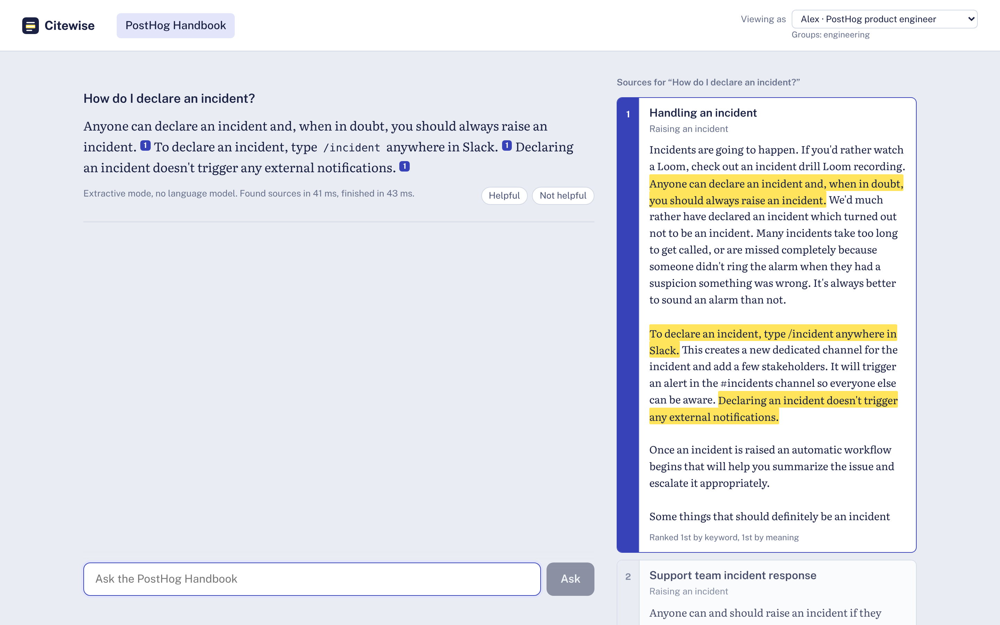
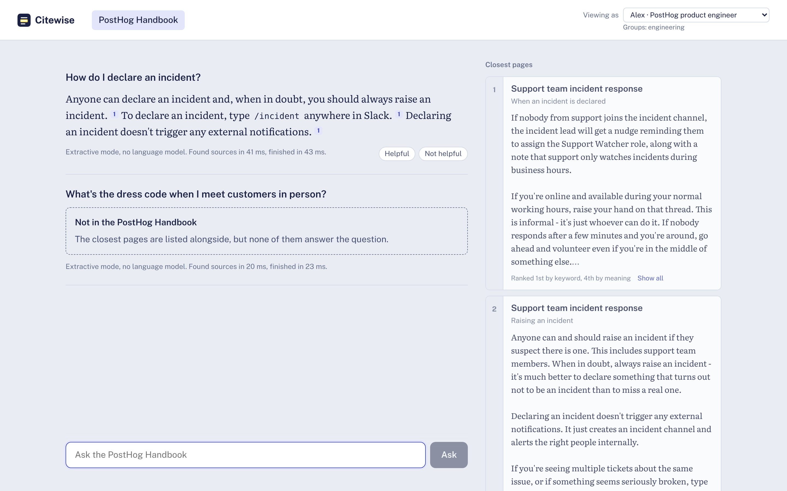

# Citewise

Ask a company handbook a question and get an answer that cites the exact section it came from, built only from pages you're allowed to read. If the handbook doesn't cover it, Citewise says so instead of guessing. A labeled eval set measures all of this, and CI fails the build if retrieval gets worse or anyone can see a page they shouldn't.

It runs on two real handbooks: [PostHog's](https://posthog.com/handbook) (a ~300-person software company) and the [TTS handbook](https://handbook.tts.gsa.gov) from the U.S. General Services Administration.




When nothing it's allowed to read answers the question, it says so and shows the closest pages instead:



_Both screenshots are from extractive mode (no LLM), where the answer is the best-matching sentences. With an LLM configured the answer is written prose with the same citations; `python scripts/screenshots.py` retakes them._

## What it does

- **Hybrid search.** Keyword search (BM25) and vector search (bge-small embeddings) run side by side and are merged with Reciprocal Rank Fusion. A cross-encoder then reranks the top 30 candidates.
- **Answers with citations you can check.** Each factual sentence cites a numbered source. Citation numbers that don't point at a real source are stripped. In the UI, opening a source highlights the sentence that supports the claim.
- **Refuses instead of guessing.** It abstains before calling the LLM when nothing relevant was retrieved (the reranker score is below a threshold picked from the eval). The model can also reply `NOT_FOUND`, which becomes a "not in the handbook" answer and is never shown raw.
- **Access control inside the search.** Every chunk carries the groups allowed to read it (`config/access.yaml`), and that filter runs inside the database query. A page you can't read is never scored, reranked or sent to the model. Workspaces are isolated the same way.
- **Treats documents as untrusted.** Sources go into the prompt as delimited data, and text that looks like it's addressed to an AI is flagged on ingest. The PostHog handbook contains a real planted-injection example, which gets flagged.
- **Follow-up questions.** "And after a year?" is rewritten into a standalone question using the conversation before searching.
- **Streams.** Answers arrive token by token over Server-Sent Events. Per-stage timings (search, rerank, first token, total) are returned with every answer.
- **Production plumbing.** FastAPI, Postgres + pgvector (HNSW) or zero-setup SQLite, incremental ingestion, Prometheus metrics, request IDs, JSON logs, Docker, and CI on GitHub Actions.

## Results

The eval set is **122 hand-labeled questions** over both handbooks (`evals/datasets/handbook_qa.jsonl`):

| Slice | Count | What's expected |
|---|---|---|
| Answerable | 88 | the gold page is retrieved and the answer contains the key fact |
| Answerable, paraphrased | 16 | same, but the question avoids the page's own wording ("Will the government chip in for my bus pass?") |
| Not in the handbook | 8 | abstain |
| Asked in the wrong workspace | 4 | abstain (a TTS question asked of the PostHog handbook) |
| Restricted | 6 | the answer exists, but in a page the asker can't read: abstain, and never retrieve it |

**Retrieval** (document level, both handbooks, 104 answerable questions):

| Configuration | Hit@1 | Hit@5 | MRR@10 | Hit@5, paraphrased | Access leaks |
|---|---|---|---|---|---|
| Keyword only (SQLite FTS5 BM25) | 74.0% | 92.3% | 0.824 | 68.8% | 0 |
| Vector only, static embeddings (WordLlama 256-d) | 64.4% | 82.7% | 0.715 | 75.0% | 0 |
| Hybrid: BM25 + WordLlama | 76.0% | 95.2% | 0.840 | 81.2% | 0 |
| Vector only (bge-small-en-v1.5) | _run it_ | _run it_ | _run it_ | _run it_ | |
| Hybrid: BM25 + bge-small | _run it_ | _run it_ | _run it_ | _run it_ | |
| **Hybrid + rerank (default)** | _run it_ | _run it_ | _run it_ | _run it_ | |

**Answers:**

| Answer mode | Answered | Key fact in answer | Cites the right page | Correct abstentions |
|---|---|---|---|---|
| Extractive, no LLM | 68.3% | 61.8% | 90.1% | 11 / 18 |
| Groq `openai/gpt-oss-120b` | _run it_ | _run it_ | _run it_ | _run it_ |

Fill in the `_run it_` rows with `make eval` (downloads about 200 MB of models once) and `make eval-answers` (needs an LLM key, see below; on a free tier it's slow, since rate-limit responses are waited out and retried). The full report, including every miss, is written to `evals/reports/latest.md`.

**What the eval shows so far:**

- **Keyword search is a strong baseline until people stop using the handbook's words.** It finds 96.6% of pages when the question reuses the page's wording, but only 68.8% when it's paraphrased. Even weak static embeddings do better there (75.0%), and hybrid gets the best of both (81.2% paraphrased, 95.2% overall). That gap is the case for hybrid search.
- **Similarity scores are a poor "should I refuse?" signal.** With static embeddings, any threshold that keeps 95% of answerable questions only blocks 11% of the ones that should be refused (`--sweep`). That's why the abstention gate uses the cross-encoder's score, and why the model has its own `NOT_FOUND` path as a second layer.
- **The eval needed testing too.** Reading the misses turned up a question whose answer is on two pages, and only one had been labeled. The label was fixed, and `tests/test_eval.py` now checks the dataset against the access rules (a "restricted" question's page must really be unreadable to the asker).

## Quick start

Needs Python 3.11+ and Node 20.19+.

```bash
python -m venv .venv && source .venv/bin/activate     # Windows: .venv\Scripts\activate
pip install -e ".[dev]"
cp .env.example .env

citewise fetch          # both handbooks at pinned commits (sparse git checkout, about 15 MB)
citewise ingest         # parse, chunk, embed, index. Re-runs only touch changed pages
pytest                  # 94 tests (the Postgres half runs when TEST_DATABASE_URL is set)

cd web && npm install && npm run build && cd ..
citewise serve          # http://localhost:8000
```

From the terminal:

```bash
citewise ask "How long do I have to upload a receipt?" -w posthog --as alex
citewise search "jury duty" -w tts --as jordan       # retrieval only, with each retriever's rank
```

The UI has a **Viewing as** switch. Ask "How much is the referral bonus?" as Alex (engineer), then as Sam (hiring manager): the hiring pages only exist for Sam.

### Using an LLM

Without one, Citewise runs in **extractive mode**: it quotes the best-matching sentences, with citations. For written answers:

```bash
# in .env — Groq has a free tier
CITEWISE_LLM_PROVIDER=groq
CITEWISE_LLM_API_KEY=gsk_...
CITEWISE_LLM_MODEL=openai/gpt-oss-120b

# or fully local with Ollama
CITEWISE_LLM_PROVIDER=ollama
CITEWISE_LLM_MODEL=llama3.2
```

Any OpenAI-compatible API works (`CITEWISE_LLM_PROVIDER=openai_compatible` plus `CITEWISE_LLM_BASE_URL`). Rate limits and server errors are retried with exponential backoff and jitter, honouring `Retry-After`; a bad key fails immediately.

### With Docker (Postgres + pgvector)

```bash
docker compose up -d --build
docker compose run --rm api sh -c "citewise fetch && citewise ingest"
open http://localhost:8000

docker compose --profile observability up -d   # adds Prometheus on :9090
```

## Evaluation

```bash
python -m evals.run                         # every retriever configuration, per-slice
python -m evals.run --sweep                 # pick the abstention threshold
python -m evals.run --answers --judge       # generate answers, plus an LLM-as-judge faithfulness check
make ablation                               # same eval with WordLlama embeddings in a separate index (Python 3.11-3.13)
```

| Metric | Meaning |
|---|---|
| Hit@k | The gold page is among the top k distinct pages retrieved |
| MRR@10 | 1 / rank of the first gold page (0 if not in the top 10) |
| Access leaks | Retrieved chunks the asker may not read, checked against `access.yaml` directly so a stale index is caught too. Must be 0 |
| Key fact in answer | The answer contains the labeled fact ("14 days", "$5,000"), format-tolerant |
| Cites the right page | At least one citation points at a gold page |
| Correct abstentions | Unanswerable, wrong-workspace and restricted questions that got "not in the handbook" |
| Judge | An LLM checks that every claim is stated in the cited sources (`--judge`) |

The `--min-hit5`, `--min-mrr`, `--min-abstention` and `--min-key-facts` flags make the command exit with an error, which is how CI blocks a regression. Any access leak fails the run regardless.

## API

| Method | Path | Purpose |
|---|---|---|
| `POST` | `/v1/ask` | Cited answer as JSON: text, cited source numbers, sources, abstention reason, timings, token usage |
| `POST` | `/v1/ask/stream` | Same, as Server-Sent Events: `sources`, then `token`s, then `answer` |
| `POST` | `/v1/search` | Retrieval only, with keyword rank, vector rank and rerank score per hit |
| `POST` | `/v1/feedback` | Thumbs up or down on one of your answers |
| `GET` | `/v1/me` | Your workspaces and groups |
| `GET` | `/healthz`, `/readyz`, `/metrics` | Liveness, readiness (DB up and index non-empty), Prometheus |

Interactive docs at `/docs`. Requests use `Authorization: Bearer <key>`; the demo keys are in `config/access.yaml`.

## How it works

[docs/architecture.md](docs/architecture.md) has the diagram and the reasoning behind each choice (two stores, rank fusion, the abstention gate, citation checks, incremental ingestion). [docs/operations.md](docs/operations.md) covers metrics, useful PromQL and a short runbook.

```
src/citewise/
  ingest/       markdown.py (MDX/Liquid cleanup), chunker.py, pipeline.py (incremental), sources.py (pinned git fetch)
  store/        sqlite.py (FTS5 + NumPy), postgres.py (tsvector + pgvector HNSW), base.py (interface)
  retrieval/    retriever.py (BM25 + vectors, RRF, cross-encoder rerank, access filter)
  generation/   answerer.py, llm.py (OpenAI-compatible client, retries, streaming), prompts.py, guardrails.py
  api/          app.py (FastAPI, SSE, auth), metrics.py
  cli.py        citewise fetch | ingest | search | ask | serve | info
evals/          run.py, metrics.py, datasets/handbook_qa.jsonl
web/            React + TypeScript UI (Vite)
config/         workspaces.yaml (sources + pinned commits), access.yaml (rules + demo users)
```

## Data and licenses

The handbooks aren't stored in this repo. `citewise fetch` downloads them at the commits pinned in `config/workspaces.yaml`.

- PostHog handbook: the `/contents` folder of [PostHog/posthog.com](https://github.com/PostHog/posthog.com) is MIT licensed.
- TTS handbook: [18F/handbook](https://github.com/18F/handbook) is a U.S. government work in the public domain (CC0).

The access rules are simulated (both handbooks are public), but the mechanism is the real one.

Code: MIT.
