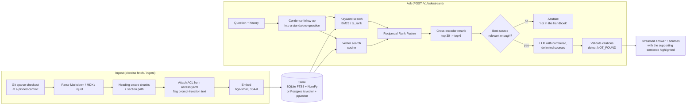

# Architecture

The access filter (workspace + the reader's groups) is applied **inside** both searches,
so a page the reader may not see is never scored, never reranked and never put in a prompt.

## Decisions and trade-offs

**Two stores behind one interface.** SQLite (FTS5 for BM25, one NumPy matrix per
workspace for vectors) means `pip install` and go: no Docker, no services, and the full
test suite runs in a few seconds. Postgres + pgvector is the deployment target: HNSW
index, GIN indexes on the tsvector and the ACL array, many workers. Every store test runs
against both, so they can't drift apart.

**Hybrid retrieval, fused by rank.** Keyword search is excellent when the question
shares the page's words ("FMLA", "Brex", "Tock") and weak on paraphrases; embeddings
are the reverse. The eval shows both effects (see the README). Their scores are on
unrelated scales, so they're combined with Reciprocal Rank Fusion, which only uses ranks
and needs no tuning.

**Rerank, then gate.** A cross-encoder reads the question and the passage together, so
its score is a much better "does this answer it?" signal than vector similarity. The same
score drives the abstention gate: if the best of the top six is below the threshold, the
LLM is never called. The threshold comes from a sweep over the labeled set
(`python -m evals.run --sweep`), not a guess.

**Two layers of abstention.** The gate catches questions with nothing relevant at all.
The model catches the rest: it's told to reply exactly `NOT_FOUND` when the sources don't
answer the question, and the stream holds back the first few characters so that sentinel
never flashes up in the UI before turning into a "not in the handbook" message.

**Citations are checked, not trusted.** Citation numbers that don't match a source are
removed and counted. An answer with no citations at all is marked ungrounded and the UI
says so.

**Sources are data, not instructions.** Each source is wrapped in a numbered `<source>`
element and the system prompt says instructions inside them must be ignored. Ingestion
also flags text that looks like it's addressed to an AI system. This isn't hypothetical:
the PostHog handbook contains a real example of a planted prompt injection (on a page
about AI coding agents), and it's flagged on ingest.

**Incremental, reproducible ingestion.** Each document's hash covers its bytes, its access
rule and the chunking settings. Re-running ingest skips what hasn't changed, and editing
`access.yaml` re-indexes exactly the pages whose permissions changed. Handbooks are
fetched at pinned commits, so the index and the labeled eval set always describe the same
text.

**One HTTP client for every LLM provider.** Groq, OpenAI, Ollama and OpenRouter all speak
the OpenAI chat API, so the client is written against that API with httpx rather than a
vendor SDK. Rate limits and 5xx errors are retried with exponential backoff and full jitter
(honouring `Retry-After`); errors retrying can't fix fail immediately; a stream is only
retried if it fails before its first token.

## What I'd do next

- Replace demo API keys with OIDC, mapping identity-provider groups to `access.yaml` groups.
- Semantic cache for repeated questions, keyed by question embedding **and** the reader's groups.
- Grow the eval set from thumbs-down feedback (`/v1/feedback` already stores it with the sources that were shown).
- Per-tenant rate limits and token budgets.
